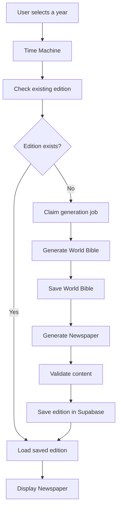

 
<div align="center">

# ⏳ KAALCHAKRA
### THE WHEEL OF TIME

**An AI-powered journey into imagined futures.**

*Choose a year. Travel through time. Discover the world that awaits.*

<br/>

[](https://kaalchakra-eight.vercel.app/)
[](https://nextjs.org/)
[](https://www.typescriptlang.org/)
[](https://ai.google.dev/)
[](https://vercel.com/)

<br/>

**🌍 Global Perspective · 🇮🇳 Indian Roots · ⏳ Infinite Possibilities**

</div>

---

## The Idea

**KAALCHAKRA (कालचक्र)** — The Wheel of Time.

What if you could open a newspaper from the year 3000?

What might humanity be discussing in 2045?  
How could civilization evolve by 10,000 AD?  
What might the world look like a million years from now?

KAALCHAKRA is an AI-powered fictional future newspaper that lets you explore imagined versions of the world across different points in time.

Choose a year, enter the time machine, and discover a newspaper from that imagined future.

Every edition builds its own fictional world, developments, stories, and perspectives.

The goal is simple: **turn curiosity about the future into an experience you can explore.**

> KAALCHAKRA is a work of speculative fiction, not a prediction of the future.

## Explore KAALCHAKRA

<div align="center">

### [ENTER THE TIME MACHINE ↗](https://kaalchakra-eight.vercel.app/)

*Your journey into tomorrow starts here.*

</div>

---

## The Experience

### 01 — Explore Time

- Select any positive year.
- Navigate through an interactive horizontal timeline.
- Enter a year manually.
- Explore distant eras and imagined timelines.

### 02 — The Time Machine

- Chakra-inspired animated time portal.
- SVG-based visual effects with rings, particles, and lighting.
- Generation-aware transitions.
- Reduced-motion accessibility support.

### 03 — AI-Powered World Building

Every new year begins with a **World Bible** — a contextual foundation for that imagined future.

It establishes the world's fictional background and provides continuity for the newspaper generated from it.

### 04 — The Future Newspaper

Each generated edition brings together different perspectives from its imagined year.

| Newspaper Content | Quantity |
|---|---:|
| Lead Story | 1 |
| India | 1 |
| World | 1 |
| Science & Technology | 1 |
| Society | 1 |
| Beyond Earth | 1 |
| Quick Briefs | 3 |

Full articles include:

- Headline and subtitle
- Summary and byline
- Article body
- Key highlights
- What the development means
- Image prompt metadata

### 05 — Persistent Editions

- Editions are stored in Supabase.
- Previously generated years can be loaded again.
- Atomic database operations help prevent duplicate generation.
- Interrupted generation jobs can be retried after their leases expire.
- Saved World Bible context can be reused.

### 06 — Time Shards

Waiting for an edition should feel like part of the journey.

Instead of a conventional loading spinner, KAALCHAKRA includes an interactive waiting mini-game called **Time Shards**.

### 07 — Personalization

- English and Hindi interface.
- Ivory-and-gold editorial identity.
- Optional dark mode.
- Responsive interface.
- Session-based generation caching.

---

## How It Works

KAALCHAKRA uses a two-stage AI content generation pipeline.



### Generation Pipeline

1. The frontend requests the selected edition's status.
2. The backend checks whether an edition for that year already exists.
3. If generation is required, an atomic database claim helps prevent duplicate jobs.
4. Gemini generates the World Bible.
5. The World Bible is saved.
6. Gemini generates the newspaper using that context.
7. The generated content is validated.
8. The completed edition is stored in Supabase.
9. The frontend checks generation status and displays the newspaper when ready.

If newspaper generation fails after the World Bible has been saved, a subsequent attempt can reuse the existing world context.

---

## Architecture

KAALCHAKRA follows a server-side AI generation architecture.

| Layer | Responsibility |
|---|---|
| Next.js App Router | Application routing and rendering |
| React Components | Interactive user interface |
| Edition Client | Status checking and polling |
| API Routes | Generation orchestration |
| Gemini Integration | AI content generation |
| Generation Pipeline | World Bible and newspaper creation |
| Supabase | Persistent storage and generation coordination |
| Vercel | Application deployment |

### Database Design

Three primary tables support the generation workflow:

| Table | Purpose |
|---|---|
| `editions` | Stores World Bibles and newspaper editions |
| `usage_daily` | Tracks daily generation usage |
| `rate_limits` | Tracks hourly request limits |

Database functions provide atomic generation claims, rate limiting, and generation-slot management.

### Security & Reliability

- Supabase service-role access stays server-side.
- Row Level Security is enabled without public policies.
- Raw IP addresses are not stored for rate limiting.
- Daily generation limits help control API usage.
- Per-IP hourly limits help reduce abuse.
- Gemini model fallback and retry handling improve resilience.
- Saved editions avoid unnecessary AI generation calls.

---

## Technology Stack

| Technology | Purpose |
|---|---|
| Next.js 16.4.6 | Full-stack framework |
| React | UI development |
| TypeScript | Type safety |
| Tailwind CSS v4 | Styling |
| Google Gemini API | AI content generation |
| `@google/genai` | Gemini SDK |
| Supabase PostgreSQL | Database |
| `@supabase/supabase-js` | Database integration |
| SVG | Time-machine animation |
| Vercel | Deployment |

---

## Project Structure

```text
Kaalchakra/
│
├── app/
│   ├── api/
│   │   └── edition/
│   ├── time-machine/
│   ├── travel/
│   ├── newspaper/
│   ├── about/
│   ├── globals.css
│   ├── layout.tsx
│   └── page.tsx
│
├── components/
│   ├── TravelScene.tsx
│   ├── WaitingGame.tsx
│   ├── NewspaperRoute.tsx
│   ├── NewspaperFront.tsx
│   ├── ArticleView.tsx
│   ├── StoryArt.tsx
│   ├── EditionGate.tsx
│   ├── LanguageProvider.tsx
│   ├── ThemeProvider.tsx
│   └── ...
│
├── lib/
│   ├── gemini.ts
│   ├── prompts.ts
│   ├── worldBible.ts
│   ├── edition.ts
│   ├── editionStore.ts
│   ├── editionClient.ts
│   ├── generateEdition.ts
│   ├── limits.ts
│   ├── supabase.ts
│   └── ...
│
├── public/
├── next.config.ts
├── package.json
└── README.md
```

---

## Run Locally

Want to explore the code or run your own instance?

### Prerequisites

- Node.js
- npm
- Google Gemini API key
- Supabase project

### 1. Clone the Repository

```bash
git clone https://github.com/Satyamsinha-dev/Kaalchakra.git

cd Kaalchakra
```

### 2. Install Dependencies

```bash
npm install
```

### 3. Configure Environment Variables

Create a `.env.local` file in the project root.

```env
GEMINI_API_KEY=your_gemini_api_key

SUPABASE_URL=your_supabase_project_url
SUPABASE_SERVICE_ROLE_KEY=your_supabase_service_role_key

DAILY_GENERATION_CAP=10
IP_HOURLY_LIMIT=5

RATE_LIMIT_SALT=your_random_secret
```

Optional: configure `GEMINI_MODELS` if your deployment uses a custom model fallback list.

Get your API key from [Google AI Studio](https://aistudio.google.com/).

Create your database project at [Supabase](https://supabase.com/).

Configure the required database tables and SQL functions before running generation requests.

**Security Notice:** Never expose the Supabase service-role key through a `NEXT_PUBLIC_` variable. Never commit `.env.local` or API secrets to GitHub.

### 4. Start the Development Server

```bash
npm run dev
```

Open [http://localhost:3000](http://localhost:3000).

### 5. Build for Production

```bash
npm run build

npm run start
```

---

## Design Philosophy

KAALCHAKRA combines the visual language of classic editorial journalism with the curiosity of futuristic exploration.

Its design identity draws from:

- Ivory backgrounds and antique gold accents.
- Editorial-style headlines.
- Minimal interface typography.
- Chakra and astrolabe-inspired visual elements.
- Immersive transitions.
- A global perspective with Indian roots.

The goal is to make exploring an imagined future feel like opening a newspaper from another time.

---

## Current Limitations

The following are not yet implemented:

- Hindi translation of generated newspaper articles. Hindi currently applies to the interface.
- Actual AI-generated newspaper images. Current story artwork uses designed visual placeholders.
- Shareable newspaper cards.
- Sound effects.
- Pre-generated popular-year editions.

These limitations are documented to distinguish existing functionality from future possibilities.

---

## Project Purpose

KAALCHAKRA is an independent engineering and creative exploration project.

It brings together:

- Full-stack web development.
- AI integration and structured generation.
- Database architecture.
- Asynchronous background processing.
- API reliability and rate limiting.
- Interactive UI and animation.
- Creative product design.

It explores how AI, engineering, and storytelling can work together to create a different kind of digital experience.

---

## Disclaimer

KAALCHAKRA is an experimental fictional storytelling project.

All generated articles, events, people, organizations, technologies, and scenarios describing future years are fictional and speculative unless explicitly stated otherwise.

Nothing published in these editions should be considered factual news, financial advice, scientific evidence, or a prediction of future events.

---

<div align="center">

## KAALCHAKRA
### The Wheel of Time

*The future is not written. It is imagined.*

<br/>

**Built with curiosity, code, and imagination.**

[Live Experience](https://kaalchakra-eight.vercel.app/) · [GitHub Repository](https://github.com/Satyamsinha-dev/Kaalchakra) · [Developer Profile](https://github.com/Satyamsinha-dev)

</div>