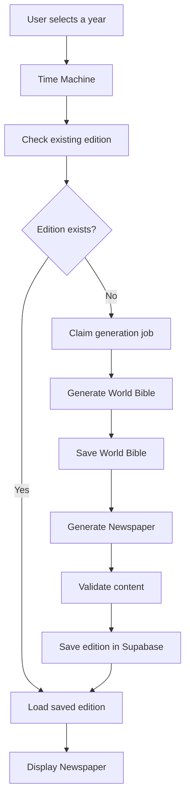

# KAALCHAKRA — The Wheel of Time

<p align="center">
  <strong>An AI-powered journey into imagined futures.</strong>
</p>

<p align="center">
  <em>Choose a year. Travel through time. Discover the world that awaits.</em>
</p>

<p align="center">
  <a href="https://github.com/Satyamsinha-dev/Kaalchakra">
    
  </a>
  
  
  
</p>

<p align="center">
  <strong>🌍 Global Perspective · 🇮🇳 Indian Roots · ⏳ Infinite Possibilities</strong>
</p>

---

## About the Project

**KAALCHAKRA (कालचक्र)**, meaning *The Wheel of Time*, is an AI-powered fictional future newspaper that allows anyone to explore imagined versions of the world across different points in time.

What might the world look like in 2045?

What could civilization become in the year 3000?

What would humanity experience 10,000 years from now?

Choose a year, enter the time machine, and explore a newspaper edition generated from an imagined future world.

Each edition has its own fictional world context, developments, stories, and perspectives.

KAALCHAKRA transforms AI-generated storytelling into an immersive editorial experience rather than a conventional chatbot interface.

> **A work of fiction, not a prediction.** All future editions are AI-generated speculative scenarios and should never be interpreted as real news or forecasts.

---

## Experience

**Live Demo:** Coming soon

**Repository:** https://github.com/Satyamsinha-dev/Kaalchakra

---

## Features

### 01. Explore Time

- Select any positive year.
- Navigate through a horizontal timeline.
- Enter a year manually.
- Discover different eras and timelines.

### 02. The Time Machine

- Chakra-inspired animated time portal.
- SVG-based animation with rings, particles, and lighting.
- Generation-aware transitions.
- Reduced-motion accessibility support.

### 03. AI-Powered World Building

Every new year starts with a World Bible that establishes the fictional world's context.

This provides continuity between the imagined world and its newspaper edition.

### 04. Future Newspaper

Each edition contains:

| Content | Quantity |
|---|---:|
| Lead Story | 1 |
| India | 1 |
| World | 1 |
| Science & Technology | 1 |
| Society | 1 |
| Beyond Earth | 1 |
| Quick Briefs | 3 |

Every full article includes a headline, subtitle, summary, byline, body paragraphs, key highlights, an explanation of what the development means, and an image prompt.

### 05. Persistent Editions

- Generated editions are stored in Supabase.
- Previously generated years are reused.
- Duplicate generation requests are prevented through atomic database operations.
- Interrupted generation jobs can be retried after their leases expire.

### 06. Waiting Experience

Instead of showing a conventional loading spinner, users experience an interactive mini-game called **Time Shards** while waiting for an edition to finish generating.

### 07. Personalization

- English and Hindi interface.
- Ivory-and-gold editorial theme.
- Optional dark mode.
- Responsive interface.
- Session-based generation caching.

---

## How It Works

KAALCHAKRA uses a two-stage AI content generation pipeline.



### Generation Pipeline

1. The frontend requests the edition status.
2. The backend checks whether the selected year already exists.
3. If a new edition is required, an atomic database claim prevents duplicate generation.
4. Gemini generates the World Bible.
5. The World Bible is saved immediately.
6. Gemini generates the newspaper using that context.
7. The generated content is validated.
8. The completed edition is saved in Supabase.
9. The frontend polls the actual generation status and displays the newspaper when ready.

If generation fails after the World Bible has been saved, subsequent attempts can reuse the existing world context.

---

## Architecture

KAALCHAKRA follows a server-side generation architecture.

| Layer | Responsibility |
|---|---|
| Next.js App Router | Application routing and rendering |
| React Components | Interactive user interface |
| Edition Client | Status checking and polling |
| API Routes | Generation orchestration |
| Gemini Integration | AI content generation |
| Generation Pipeline | World Bible and newspaper creation |
| Supabase | Persistent storage and generation coordination |

### Database

Three primary tables are used:

| Table | Purpose |
|---|---|
| `editions` | Stores World Bibles and newspaper editions |
| `usage_daily` | Tracks daily generation usage |
| `rate_limits` | Tracks hourly request limits |

Database functions provide atomic generation claims, rate limiting, and generation-slot management.

### Security and Reliability

- Supabase service-role access stays server-side.
- Row Level Security is enabled without public policies.
- Raw IP addresses are not stored for rate limiting.
- Daily generation limits help control API usage.
- Per-IP hourly limits help reduce abuse.
- Gemini model fallback and retry handling improve resilience.
- Saved editions avoid unnecessary AI generation calls.

---

## Technology Stack

| Technology | Usage |
|---|---|
| Next.js 16.4.6 | Full-stack framework |
| React | UI development |
| TypeScript | Type safety |
| Tailwind CSS v4 | Styling |
| Google Gemini API | AI content generation |
| `@google/genai` | Gemini SDK |
| Supabase PostgreSQL | Database |
| `@supabase/supabase-js` | Supabase integration |
| SVG | Time-machine animation |
| Vercel | Planned deployment platform |

---

## Project Structure

```text
Kaalchakra/
│
├── app/
│   ├── api/
│   │   └── edition/
│   ├── time-machine/
│   ├── travel/
│   ├── newspaper/
│   ├── about/
│   ├── globals.css
│   ├── layout.tsx
│   └── page.tsx
│
├── components/
│   ├── TravelScene.tsx
│   ├── WaitingGame.tsx
│   ├── NewspaperRoute.tsx
│   ├── NewspaperFront.tsx
│   ├── ArticleView.tsx
│   ├── StoryArt.tsx
│   ├── EditionGate.tsx
│   ├── LanguageProvider.tsx
│   ├── ThemeProvider.tsx
│   └── ...
│
├── lib/
│   ├── gemini.ts
│   ├── prompts.ts
│   ├── worldBible.ts
│   ├── edition.ts
│   ├── editionStore.ts
│   ├── editionClient.ts
│   ├── generateEdition.ts
│   ├── limits.ts
│   ├── supabase.ts
│   └── ...
│
├── public/
│
├── next.config.ts
├── package.json
└── README.md
```

---

## Getting Started

### Prerequisites

- Node.js
- npm
- Google Gemini API key
- Supabase project

### 1. Clone the Repository

```bash
git clone https://github.com/Satyamsinha-dev/Kaalchakra.git
cd Kaalchakra
```

### 2. Install Dependencies

```bash
npm install
```

### 3. Configure Environment Variables

Create a `.env.local` file in the root directory.

```env
GEMINI_API_KEY=your_gemini_api_key

SUPABASE_URL=your_supabase_project_url
SUPABASE_SERVICE_ROLE_KEY=your_supabase_service_role_key

DAILY_GENERATION_CAP=10
IP_HOURLY_LIMIT=5
RATE_LIMIT_SALT=your_random_secret

GEMINI_MODELS=gemini-3.5-flash-lite,gemini-3.1-flash-lite,gemini-3.5-flash,gemini-3.6-flash
```

Get your Gemini API key from [Google AI Studio](https://aistudio.google.com/).

Create your database project at [Supabase](https://supabase.com/).

Configure the required database tables and SQL functions before running generation requests.

**Security Notice:** Never expose the Supabase service-role key through a `NEXT_PUBLIC_` variable. Never commit `.env.local` or API secrets to GitHub.

### 4. Run the Development Server

```bash
npm run dev
```

Open http://localhost:3000.

### 5. Build for Production

```bash
npm run build
npm run start
```

---

## Current Limitations

The following features are not yet implemented:

- Hindi translation of generated newspaper articles. Hindi currently applies to the interface only.
- Actual AI-generated newspaper images. Current story artwork uses designed visual placeholders.
- Shareable newspaper cards.
- Sound effects.
- Pre-generated popular-year editions.

These are intentionally documented to distinguish implemented functionality from future possibilities.

---

## Design Philosophy

KAALCHAKRA combines the visual language of classic editorial journalism with the curiosity of futuristic exploration.

Its design identity is based on:

- Ivory backgrounds and antique gold accents.
- Newsreader-inspired editorial headlines.
- Minimal interface typography.
- Chakra and astrolabe-inspired visual elements.
- Immersive transitions.
- A global perspective with Indian roots.

The goal is to make exploring an imagined future feel like opening a newspaper from another time.

---

## Project Purpose

KAALCHAKRA is a personal engineering and creative exploration project.

It brings together:

- Full-stack web development.
- AI integration and structured generation.
- Database architecture.
- Asynchronous background processing.
- API reliability and rate limiting.
- Interactive UI and animation.
- Creative product design.

It is an exploration of how AI, engineering, and storytelling can work together to create a different kind of digital experience.

---

## Disclaimer

KAALCHAKRA is an experimental fictional storytelling project.

All generated articles, events, people, organizations, technologies, and scenarios describing future years are fictional and speculative unless explicitly stated otherwise.

Nothing published in these editions should be considered factual news, financial advice, scientific evidence, or a prediction of future events.

---

<p align="center">
  <strong>KAALCHAKRA — The Wheel of Time</strong>
  <br>
  <em>The future is not written. It is imagined.</em>
</p>

<p align="center">
  Built with curiosity, code, and imagination.
  <br>
  <a href="https://github.com/Satyamsinha-dev">GitHub</a>
</p>